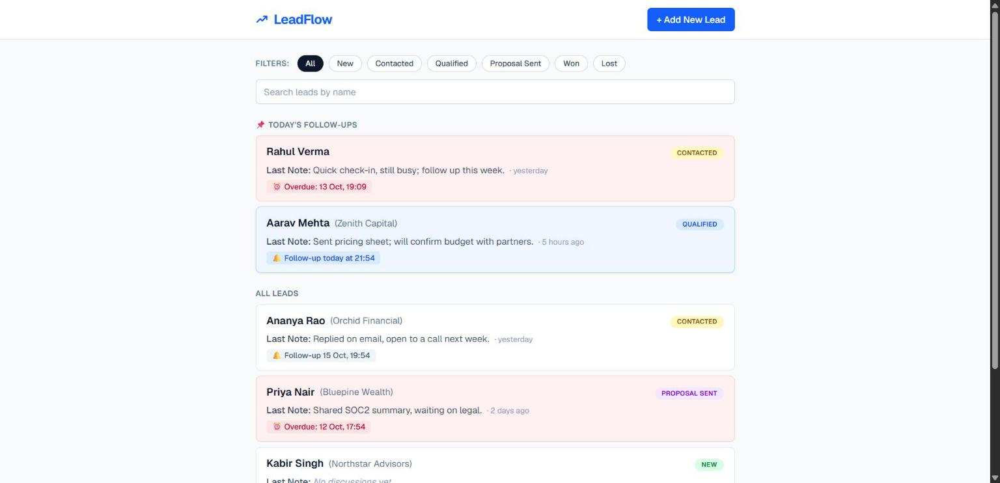
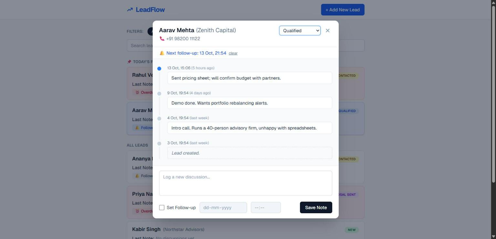
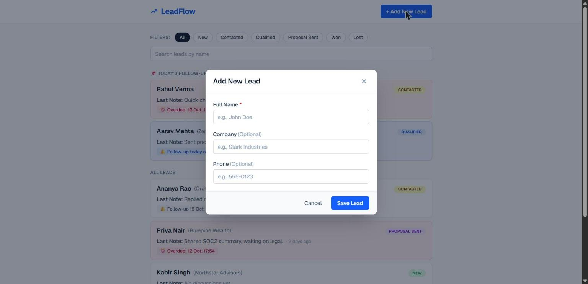
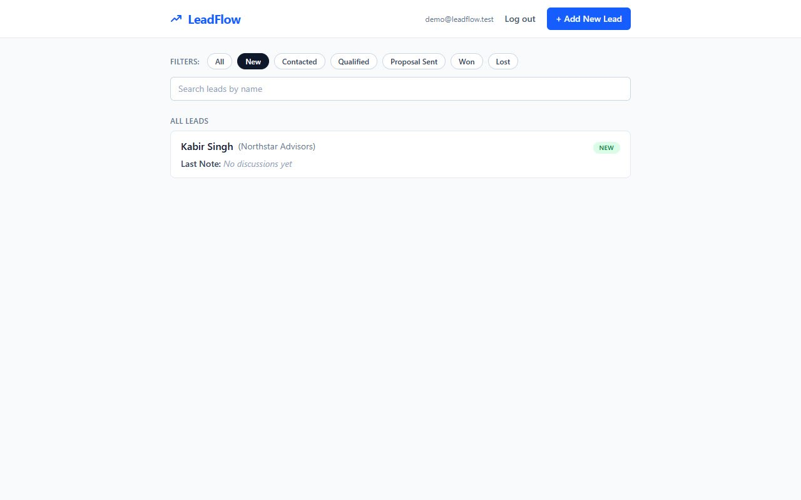
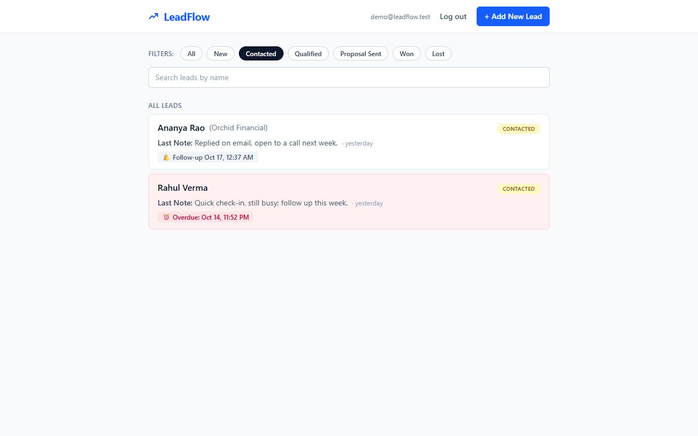
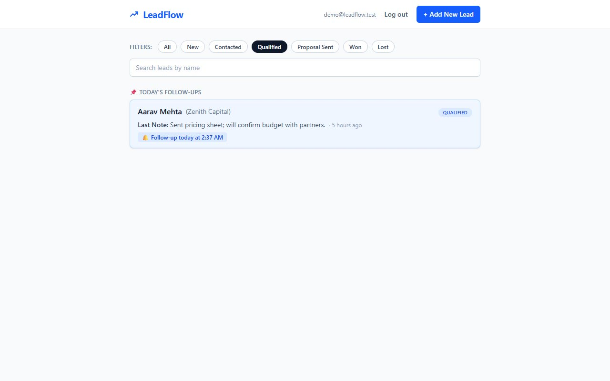
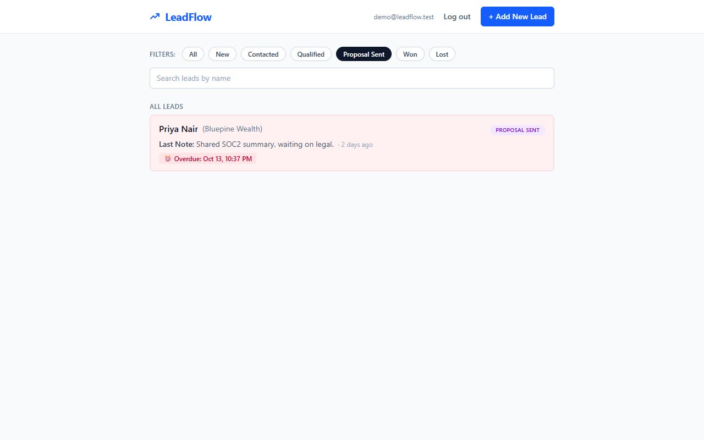
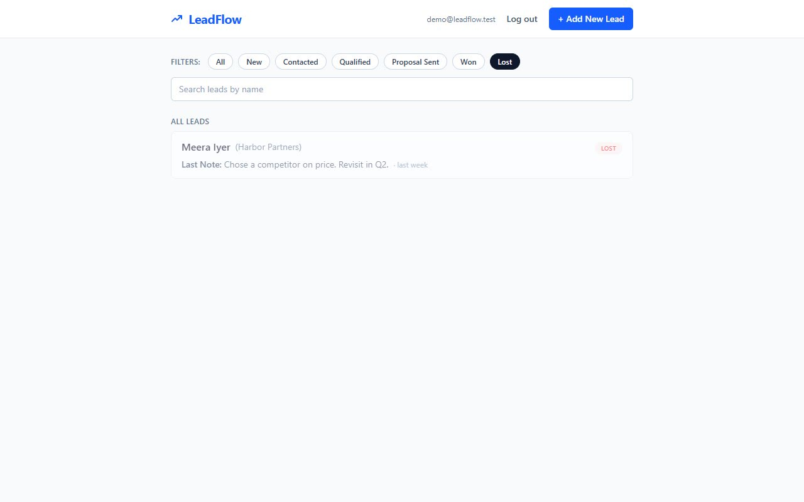

# LeadFlow

[](https://github.com/Shaurya55555/leadflow-pravarai/actions/workflows/ci.yml)

A single-screen lead management tool: track leads, log every discussion, and set follow-up reminders.

Built for the PravarAI full-stack intern assessment.

- **Frontend:** Next.js 16 (App Router), TypeScript, Tailwind CSS
- **Backend:** FastAPI, SQLAlchemy, SQLite
- **Tests:** pytest (API), Vitest + Testing Library (UI and time logic)
- **CI:** GitHub Actions (backend tests, frontend lint/typecheck/tests/build, Docker Compose smoke test)

| Lead list | Lead timeline | Add lead |
| --- | --- | --- |
|  |  |  |

Every status view (filters applied):

| New | Contacted | Qualified |
| --- | --- | --- |
|  |  |  |

| Proposal Sent | Won | Lost |
| --- | --- | --- |
|  |  |  |

Login screen: [`docs/screenshots/04-login.jpg`](docs/screenshots/04-login.jpg)

**Demo video:** https://drive.google.com/file/d/1sGr0Vudb6sKC4pSj6iAbZdKQtwGhCbm-/view?usp=sharing

## Features

**Required**

| Requirement | Where it lives |
| --- | --- |
| List shows name, status badge, last note, time since last discussion | `frontend/src/components/LeadRow.tsx` |
| Filter by all six statuses | status chips; server-side `GET /leads?status=` |
| Today's follow-ups pinned on top | `pinTodaysFollowUps` in `frontend/src/lib/time.ts` |
| Timeline dialog, newest first, status change, add note with optional follow-up | `LeadTimelineDialog.tsx`, `GET/POST /leads/{id}/discussions`, `PATCH /leads/{id}` |
| Saving a follow-up updates the lead and the list immediately | the API returns the updated lead; the UI merges it without a refetch |
| Add lead (name required, company and phone optional, status defaults to New) | `AddLeadDialog.tsx`, `POST /leads` |

**Bonus**

- Search by name (composes with the status filter)
- Overdue follow-ups highlighted in red
- Docker Compose setup
- Login (optional in the brief): JWT sign-in, protected API, session restored on reload, log out. Demo account `demo@leadflow.test` / `leadflow123`
- Seed script: 7 leads covering all six statuses, with discussions, an overdue, a due-today and an upcoming follow-up

**Extras**

- Layout and wording follow the supplied wireframes
- Unsaved-input protection: closing a dialog with a typed note or unsaved edits asks before discarding
- Quick-set follow-up chips (Tomorrow, In 3 days, Next week, all at 10:00 local time)
- Suggested follow-up: a deterministic, rule-based suggestion (no AI service involved) from the lead's status and the note text, for example "call on Friday" suggests the next Friday. It only fills the form when you click "Use suggestion" and never saves anything on its own
- Edit lead details (name, company, phone) from the timeline dialog
- "Lead created" appears in the timeline as a system event and is never stored as a discussion
- Won and Lost leads are dimmed and never flagged as overdue

## Run locally

Prerequisites: Python 3.11+ and Node 20+ (22 recommended).

### 1. Backend

```bash
cd backend
python -m venv .venv
# macOS/Linux: source .venv/bin/activate     Windows: .venv\Scripts\activate
pip install -r requirements.txt
python -m app.seed            # optional demo data; add --reset to reseed from scratch
uvicorn app.main:app --reload --port 8000
```

Interactive API docs: http://localhost:8000/docs

### 2. Frontend

```bash
cd frontend
npm install
npm run dev
```

Open http://localhost:3000 and sign in with the demo account `demo@leadflow.test` / `leadflow123` (created automatically on first start). Both services work with their defaults; copy `.env.example` files only if you need different ports or hosts.

### Docker Compose

```bash
docker compose up --build
```

Frontend on http://localhost:3000, API on http://localhost:8000. The backend seeds demo data on first boot, and the SQLite file lives in a named volume. The CI workflow builds and smoke-tests this stack on every push.

## Tests

```bash
cd backend && pytest -q          # 108 API tests
cd frontend && npm test          # 86 UI and logic tests
```

The full edge-case matrix, with the test that proves each row and the bugs the tests found, is in [`docs/TESTING.md`](docs/TESTING.md). In short:

- **API:** status codes and error shapes, validation limits, partial updates, search wildcards, combined filters, ordering with identical timestamps, CORS, seed idempotency.
- **Time logic:** today and overdue across local midnight and the UTC/local date boundary (the suite pins the timezone to Asia/Kolkata), closed leads never flagged, pin ordering.
- **UI:** saving a note with and without a follow-up, validation, failed saves keeping the typed note, double-submit prevention, status changes, the unsaved-input guard, snooze presets, the rule-based suggestion, editing lead details.

## Environment variables

All of them are listed in the root [`.env.example`](.env.example) (and per service in `backend/.env.example` and `frontend/.env.example`).

| Variable | Used by | Default | Purpose |
| --- | --- | --- | --- |
| `DATABASE_URL` | backend | `sqlite:///./leadflow.db` | SQLAlchemy connection string |
| `CORS_ORIGINS` | backend | `http://localhost:3000` | Comma-separated allowed origins |
| `SECRET_KEY` | backend | dev-only value | Signs login tokens; set a long random value outside local development |
| `ACCESS_TOKEN_MINUTES` | backend | `720` | Login lifetime |
| `DEMO_EMAIL`, `DEMO_PASSWORD` | backend | `demo@leadflow.test`, `leadflow123` | Demo account created on first start when there are no users |
| `NEXT_PUBLIC_API_URL` | frontend | `http://localhost:8000` | API base URL (inlined at build time) |

## API

| Method | Path | Notes |
| --- | --- | --- |
| POST | `/auth/login` | `{email, password}` returns `{access_token, user}`; 401 with one message for any bad credential |
| GET | `/auth/me` | Current user; needs `Authorization: Bearer <token>` |
| GET | `/leads?status=&q=` | Includes `last_note` and `last_discussion_at`; most recently touched first |
| POST | `/leads` | 201; `name` required |
| GET | `/leads/{id}` | 404 if missing |
| PATCH | `/leads/{id}` | Partial update; `follow_up_at: null` clears the follow-up |
| DELETE | `/leads/{id}` | 204; cascades to discussions |
| GET | `/leads/{id}/discussions` | Newest first |
| POST | `/leads/{id}/discussions` | 201; `{note, follow_up_at?}`; returns `{discussion, lead}` |
| GET | `/health` | Liveness check (public) |

Every `/leads` route requires a bearer token and returns 401 without one.

Validation failures return 422 with FastAPI's field-level `detail`; unknown ids return 404 with a readable message. The frontend shows the server message inline.

## Design decisions

- **UTC on the wire, local day in the UI.** Timestamps are stored and served as UTC (ISO 8601 with `Z`). "Today" and "overdue" are computed in the browser against the viewer's local calendar day, so a 9 AM IST follow-up is "today" for an IST user regardless of server timezone.
- **Append-only discussions.** Notes are never edited, which keeps the timeline trustworthy.
- **A note without a follow-up does not erase an existing follow-up.** It can be cleared explicitly from the dialog.
- **No optimistic updates.** The UI changes only after the server confirms, so a failed save is never hidden.
- **One grouped query for last notes.** The list endpoint avoids an N+1 by fetching the latest discussion per lead in a single query.
- **Closed leads are quiet.** Won and Lost leads never show overdue or pinned states, because a stale reminder on a closed deal is noise.
- **Simple, honest auth.** Passwords are hashed with salted PBKDF2, sessions are short-lived signed JWTs, and a bad email and a bad password return the same message. The token lives in `localStorage`, which is fine for this scope; an httpOnly cookie would be the next step. There is no sign-up screen, so the demo account is created on first start.

## Project structure

```
backend/
  app/            FastAPI app: models, schemas, routers, seed
  tests/          pytest suite
frontend/
  src/app/        Next.js entry, layout, error boundary
  src/components/ LeadFlowApp, LeadRow, LeadTimelineDialog, AddLeadDialog, Modal, StatusBadge
  src/lib/        API client, time helpers, types
  tests/          Vitest suite
docs/
  screenshots/    UI screenshots used above
  DEMO_SCRIPT.md  walkthrough script for the demo video
```

## AI usage

This project was built with Claude Code (Anthropic) as a pair-programming assistant. It drafted the API, components and tests; every piece was run, reviewed and verified: the backend and frontend test suites, lint, type-checking, the production build, and a manual browser pass through each flow. The tests are what I rely on for correctness, and the one behavioural bug they surfaced (a 500 on a blank PATCH name) is fixed and covered by a regression test.

## Known limitations and next steps

- Login exists, but there is no sign-up, password reset or per-user data: all signed-in users share one pipeline.
- No pagination on the lead list; fine for one rep's pipeline, and the first thing to add at scale.
- SQLite is used for zero-setup; the `DATABASE_URL` setting makes moving to Postgres a configuration change plus a migration tool such as Alembic.
